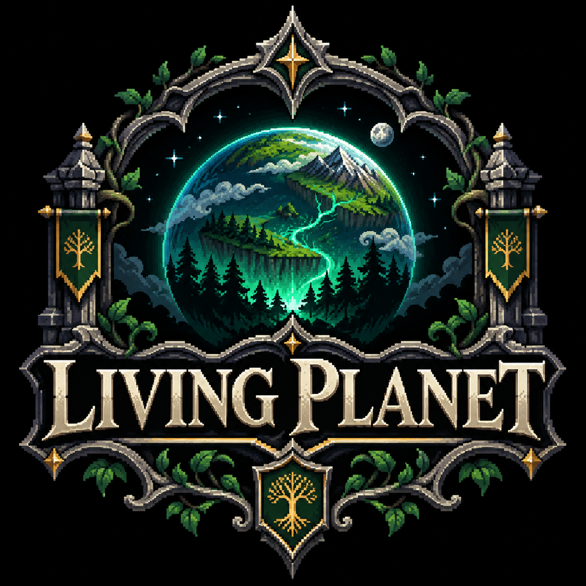
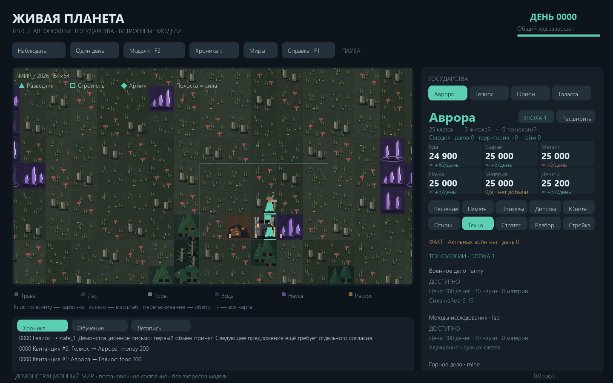
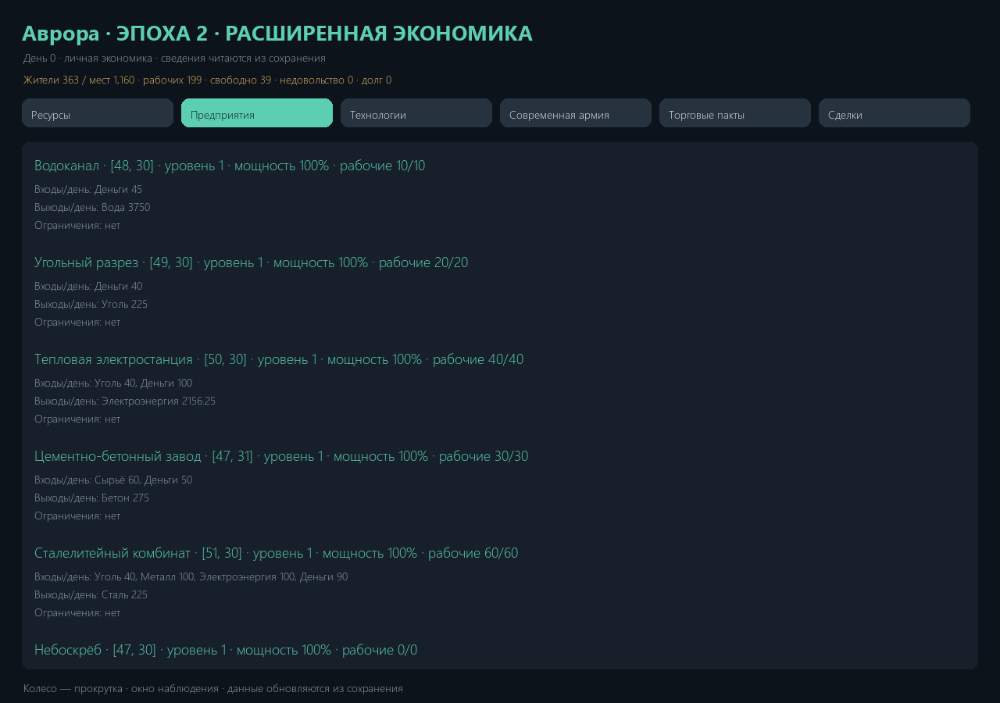
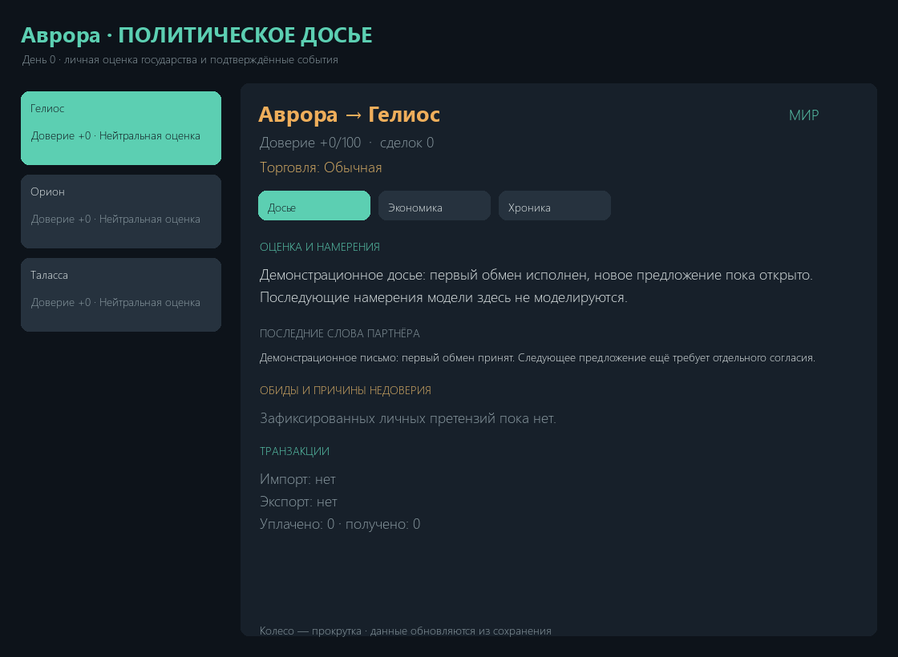
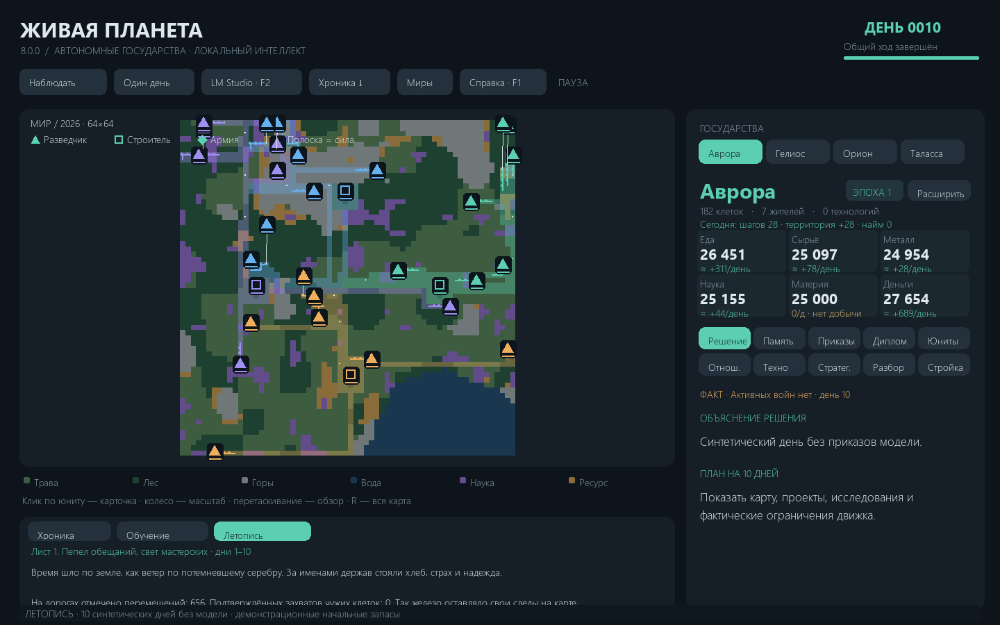
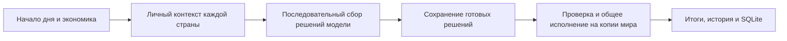

Original Living Planet («Живая планета») was created by TPECKA180; original source: https://github.com/TPECKA180/living-planet.

# 🌍 Живая планета · Living Planet

**Автономные государства. Локальные нейросети. История, которая складывается из реальных решений.**

**Язык / Language:** [English](docs/i18n/en/README.md) · [Русский](README.md) · [Español](docs/i18n/es/README.md) · [简体中文](docs/i18n/zh-CN/README.md) · [Português (Brasil)](docs/i18n/pt-BR/README.md) · [Deutsch](docs/i18n/de/README.md) · [Français](docs/i18n/fr/README.md) · [日本語](docs/i18n/ja/README.md) · [한국어](docs/i18n/ko/README.md) · [Italiano](docs/i18n/it/README.md)

[🌐 Справочник переводов и статус локализации](docs/i18n/README.md)


[Скачать 8.5.1](https://github.com/TPECKA180/living-planet/releases/tag/v8.5.1) · [SETUPGAME.exe](https://github.com/TPECKA180/living-planet/releases/download/v8.5.1/SETUPGAME.exe) · [Как установить](docs/SETUP.md) · [Галерея: 11 экранов](docs/SCREENSHOTS.md) · [Полная справка](docs/GAME_GUIDE.md) · [Все действия](docs/ACTIONS.md) · [Сторонние компоненты](docs/THIRD_PARTY_NOTICES.md)

> **Living Planet 8.5.1:** срочное обновление возвращает отдельную консоль потока модели. Во время наблюдения видны ход генерации, ответ и reasoning, если выбранная модель действительно передаёт его серверу. Для старых настроек консоль включается автоматически; её можно отключить в **Модели · F2**.

> Встроенный движок llama.cpp запускает выбранную GGUF-модель из `models`; LM Studio для игры не требуется. Фирменная иконка, установщик с выбором папки и переносимая сборка входят в релиз.

> Установщик **`SETUPGAME.exe`** также лежит в корне репозитория: нажмите файл или используйте ссылку выше. Файл `.iss` в исходном коде — сценарий сборки для разработчиков, не установщик.

<p align="center"></p>


*Реальный интерфейс pygame. На скриншотах — специально подготовленные демонстрационные миры, без личных сохранений и запросов к нейросети. Увеличенные запасы и открытые технологии служат показу возможностей, а не примером стартового баланса.*

## Мир живёт, а вы наблюдаете

«Живая планета» — независимый симулятор государств, решения в котором принимают локальные языковые модели. У каждой страны свои запасы, территория, правитель, память, планы, отношения и переписка. Вы выбираете мир и модель, запускаете день или наблюдение, а затем следите за тем, как страны развиваются, договариваются и конфликтуют.

Модель предлагает действия в структурированном ответе. Движок Python проверяет владение, доступные ресурсы, технологии, договоры и маршруты, списывает стоимость и рассчитывает последствия. Фраза «построю завод» не создаёт завод; письмо о дружбе не перечисляет деньги. У каждого исполненного или отклонённого приказа есть проверяемый результат.

| Масштаб | Что реализовано |
| --- | --- |
| **2–6 государств** | Раздельные планы, память, дипломатия и решения |
| **55 типов действий** | Развитие, строительство, исследования, торговля, армия и политика |
| **2 эпохи** | Первая эпоха и индивидуальный переход страны к индустриальной цивилизации |
| **31 ресурс** | От еды и металла до энергии, электроники и специализированной науки |
| **25 + 33 технологии** | Первая эпоха и индустриальный каталог, включая сам эпохальный переход |
| **45 современных зданий** | Жильё, добыча, заводы, энергетика, наука и оборона |
| **8 современных типов войск** | Производство, экипажи, снабжение и реальные ограничения найма |

## Быстрый старт

1. Скачайте **`SETUPGAME.exe`** из корня репозитория или из раздела Releases и установите игру.
2. Поместите одну или несколько совместимых **GGUF**-моделей в папку `models` рядом с установленной игрой. Модель можно выбрать кнопкой **Модели · F2**.
3. Создайте мир: название, 2–6 стран, seed и обычная карта либо архипелаг. Нажмите **Один день** или **Наблюдать**. Игра сама запустит и закроет локальный движок.

Для запуска из терминала после установки Python:

```bash
python -m pip install -r requirements.txt
python main.py
```

Для запуска исходников с Python: `python -m pip install -r requirements.txt` и `python main.py`. Игрокам Windows Python не нужен. Подробная инструкция по GGUF-моделям и офлайн-режиму находится в [руководстве по установке](docs/SETUP.md).

**GitHub-сборка не содержит весов модели.** Файл модели обычно занимает несколько гигабайт, поэтому в публичный релиз он не включён. Поместите собственный совместимый GGUF-файл в `models`; после этого запуск модели и игровая логика работают локально, без LM Studio, сетевого сервера или API-ключа. В локальном архиве разработчика на F модель уже находится в `models`.

## Карта: от целого мира до отдельной клетки

География воспроизводится по seed. На общей карте видны государства, местность и юниты; при увеличении появляются процедурные пиксельные детали. Можно выбирать отряды, рассматривать клетки и предварительно просматривать маршруты. Предпросмотр пути не отдаёт приказ и не тратит казну.



В режиме **архипелага** мир состоит из шести крупных островов. Исследование, торговые интересы и война сталкиваются с настоящей морской логистикой: кораблями, вместимостью транспорта, посадкой и высадкой. Технология навигации не позволяет пехоте ходить по воде.


## Экономика: у роста есть цена

Первая эпоха связывает население, производство, исследования, строительство и содержание. Индустриальная эпоха добавляет жильё, рабочих, входные материалы, энергию, цепочки производства, приоритеты предприятий, снабжение, долг и кризисы. Переход выполняется для каждой страны отдельно.

В расширенном окне экономики можно сравнить запасы и прогнозы, увидеть работающие предприятия и причины остановки производства. Один и тот же рабочий не обслуживает все заводы одновременно; отсутствие топлива или энергии ограничивает реальный выпуск.



[Ресурсы и прогноз](docs/SCREENSHOTS.md#ресурсы-и-прогноз) · [Строительство](docs/SCREENSHOTS.md#строительство) · [Каталоги и цены](docs/CATALOGS.md)

## Дипломатия, торговля и войны

Государства переписываются, ведут собственные досье и оценивают доверие. Партнёрство, rival/enemy в личной оценке и фактическая война — разные состояния. Торговые предложения требуют принятия; реальные поставки и платежи отражаются в квитанциях. Договоры могут создавать зависимость, долги и повод для конфликта.

В военной части есть платный найм, реальные перемещения, укрепления, осады, морские перевозки, капитуляция и вассалитет. Текст «мобилизуемся» не создаёт войска. Современная армия требует ресурсов и экипажей, а операции — снабжения и достижимой цели.



## Память, опыт и летопись

Память страны хранит характер, планы и прежние решения. Итоги действий становятся обратной связью для следующего запроса. Награды и эксперименты помогают модели учитывать последствия, но **не изменяют её веса и не выполняют fine-tuning**.

Хроника фиксирует события, а отдельная летопись формирует главы каждые десять завершённых дней. В стандартном режиме подготовка приказов и создание главы выполняются локально, без дополнительных советников-моделей.



## Как проходит один день



Все страны планируют до общего исполнения. Порядок применения решений циклически меняется по номеру дня. Сеть и расчёты идут в рабочем потоке, интерфейс получает снимки состояния через очередь. Незавершённый день и уже готовые решения сохраняются, поэтому после остановки не требуется создавать мир заново.

Модель получает только контекст активного государства. Запросы выполняются последовательно через локальный движок; данные игрового мира не отправляются в сеть.

## Управление

| Действие | Управление |
| --- | --- |
| Наблюдение / пауза | Кнопка **Наблюдать** или пробел |
| Завершить один общий день | **Один день** или `N` |
| Модель и настройки | **Модели · F2** · GGUF из папки `models` |
| Полная справка без интернета | `F1` |
| Масштаб карты | Колесо мыши над картой |
| Перемещение карты | Перетаскивание мышью |
| Вернуться к общей карте | `R` |
| Экономика страны | **Расширить** |
| История мира | Нижние вкладки **Хроника**, **Обучение**, **Летопись** |

## Документация

| Нужно разобраться в… | Открыть |
| --- | --- |
| Установке и подключении | [Первый запуск](docs/SETUP.md) |
| Интерфейсе и возможностях | [Галерея с пояснениями](docs/SCREENSHOTS.md) |
| Полных игровых механиках | [Руководство игрока](docs/GAME_GUIDE.md) |
| Аргументах каждого приказа | [55 действий](docs/ACTIONS.md) |
| Ресурсах, зданиях, технологиях и ценах | [Каталоги](docs/CATALOGS.md) |
| Настройках и размере контекста | [Конфигурация](docs/CONFIGURATION.md), [лимиты](docs/LIMITS.md) |
| Личном контексте и промптах | [Как работает AI](docs/AI.md) |
| Мирах и резервных копиях | [Сохранения](docs/SAVES.md) |
| Ошибках и восстановлении | [Решение проблем](docs/TROUBLESHOOTING.md) |
| Устройстве исходников | [Архитектура](docs/ARCHITECTURE.md), [интерфейсы подсистем](docs/MODULAR_ARCHITECTURE.md) |
| Проверках и подготовке выпуска | [Разработка](docs/DEVELOPMENT.md), [проверенные результаты](docs/VALIDATION.md) |

Полная HTML-справка находится в `docs/index.html` и открывается по `F1` без интернета. Список изменений — в [CHANGELOG](CHANGELOG.md).

## Проверки и границы возможностей

Автоматические проверки запускают игровые правила, сохранение и восстановление SQLite, защиту владельцев, обработку API и программные кампании. GitHub Actions выполняет проверки на Windows и Linux с Python 3.12. Сетевые тесты используют подставные ответы и не требуют весов модели. Скриншоты воспроизводятся командой `python tools/render_gallery.py` на новых синтетических мирах.

Языковая модель может выбирать слабую стратегию, ошибаться в приказах, повторяться или выдавать слишком длинный ответ. Прохождение тестов движка не доказывает качество её игры. Фактический размер контекста зависит от модели, сервера и памяти; большой `max_tokens` сам по себе его не увеличивает.

После трёх подряд неудачных шагов наблюдение останавливается с явной ошибкой. Неполное решение не исполняется; после исправления причины можно продолжить вручную. Для обрезанного по длине ответа предусмотрена одна внутренняя восстановительная попытка. Подробности и ограничения проверок перечислены в [VALIDATION](docs/VALIDATION.md).

Личные миры, настройки, ключи и журналы не публикуются. Исходный проект и его модификации распространяются по [Living Planet Free Community License v1.0](LICENSE) ([русский перевод](LICENSE.ru.md)): игра и производные версии должны оставаться бесплатными, исходники распространяемых модификаций открыты, первоначальное авторство TPECKA180 сохраняется. Это нестандартная лицензия, не одобренная OSI; сторонние компоненты имеют собственные условия.
