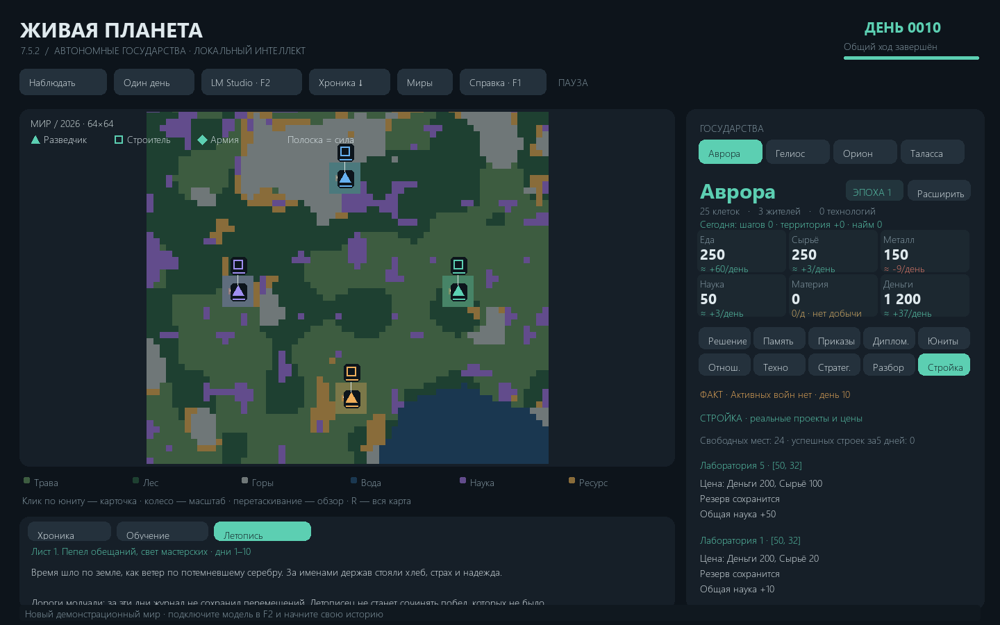

# Живая планета · 8.0.0

> 🌍 **Один из ранних проектов нового поколения ИИ-симуляторов цивилизаций**
>
> Living Planet — независимый проект в развивающемся направлении автономных симуляторов цивилизаций под управлением локальных нейросетей. Автор проекта стремится стать одним из первопроходцев этого направления, объединяя самостоятельную дипломатию, экономику, войны и формирование истории без непосредственного управления игроком.

Обновление 8.0.0. Реестр подсистем, стабильные интерфейсы и адаптеры существующего движка. Исполнение и предварительная проверка используют общий диспетчер команд. [Карта архитектуры](docs/MODULAR_ARCHITECTURE.md). Восстановление обрезанного ответа ограничено одной попыткой, повторяющееся reasoning обнаруживается в потоке.

**Автономные государства под управлением локальных языковых моделей.**

Экономика, экспансия, характеры правителей, дипломатический обман, торговая зависимость, войны и личный переход в индустриальную эпоху — в одном сохраняемом мире. Вы наблюдаете за симуляцией; решения принимают модели через LM Studio, а ресурсы, перемещения и последствия рассчитывает Python-движок.

## Быстрый старт

1. Установите **Python 3.12** и **LM Studio**. Скачайте в LM Studio текстовую instruct/chat-модель и включите сервер в разделе **Developer**.
2. Скачайте проект через **Code → Download ZIP**, распакуйте и запустите `install.bat`.
3. Откройте `run.bat`. В меню миров нажмите **LM Studio**, укажите `http://localhost:1234/v1`, обновите список моделей и выберите модель. Если сервер требует авторизацию, заполните скрытое поле API-ключа.
4. Создайте **новый мир**, выбрав число государств, seed и обычный мир или архипелаг. Нажмите **Один день** или **Наблюдать**.

Первый запуск создаёт собственный `config.json`. В репозитории и чистой сборке **нет готового мира, личных настроек, ключей, журналов, исходных пользовательских вложений или истории разработки**. Образец `config.example.json` содержит только общие значения. Модели и их веса не входят в проект.

## Что есть в игре

- 2–6 государств со своей памятью, планами, перепиской и отношениями; один общий день с последовательным получением решений и общим исполнением.
- Обычная карта и архипелаг из шести крупных островов, воспроизводимый seed, пиксельная местность и здания при приближении.
- 55 реальных типов действий: строительство, исследования, население, армии, флот, сделки, обещания, эмбарго, войны и вассалы.
- 25 технологий первой эпохи и 33 позиции индустриального каталога, включая индивидуальный эпохальный переход; 31 ресурс, 45 современных зданий и 8 современных типов войск.
- Промышленность с рабочими, жильём, входами, энергией, долгом, снабжением и кризисами; оборона, осады и игровая ракетная ветка.
- Ежедневные награды и заметки об опыте. Это обратная связь через память, **без изменения весов нейросети**.
- Локальное исполнение приказов без повторного нейросетевого «обоснования» в конце дня, уплотнение контекста и восстановление окна при ошибке интерфейса.

## Документация

| Задача | Документ |
| --- | --- |
| Установить, подключить сервер, выбрать модель | [Подключение и первый запуск](docs/SETUP.md) |
| Понять все игровые механики | [Полная справка игры](docs/GAME_GUIDE.md) |
| Найти любой приказ и его аргументы | [Все 55 действий](docs/ACTIONS.md) |
| Посмотреть ресурсы, технологии, здания, армии и цены | [Полные каталоги](docs/CATALOGS.md) |
| Настроить окно, лимиты, API-ключ и режимы | [Конфигурация](docs/CONFIGURATION.md) |
| Понять промты, изоляцию и сокращение входа | [Как работает AI](docs/AI.md) |
| Найти файлы мира и резервные копии | [Сохранения](docs/SAVES.md) |
| Исправить ошибку или долгий ход | [Решение проблем](docs/TROUBLESHOOTING.md) |
| Разобраться в коде, тестах и выпуске | [Архитектура](docs/ARCHITECTURE.md), [разработка](docs/DEVELOPMENT.md) |

Полная локальная HTML-справка открывается по **F1** и работает без интернета. На GitHub тот же материал доступен в Markdown. [Что изменилось в 8.0.0](CHANGELOG.md) · [Результаты проверок](docs/VALIDATION.md).

## Ограничения

Модель может ошибаться, затягивать переговоры или выбирать слабую стратегию. Реальные действия проверяет движок; хороший промт не гарантирует сильную игру. Длина дня зависит от модели, размера фактов, контекста, разгрузки/загрузки экземпляров и оборудования. Строгая серверная изоляция и управление загрузкой рассчитаны на нативный API LM Studio; другой OpenAI-совместимый сервер требует отдельного режима и не обеспечивает ту же проверку выгрузки.

Основная проверенная среда — Windows с Python 3.12 и pygame 2.6.1. Linux запускается командами из инструкции; отдельная Windows-консоль на нём не создаётся. Лицензия на код пока не выбрана владельцем проекта.

Обновление7.5.3: реальные торговые и военные приказы из разбора, наступательная политика и отдельная [поэтическая летопись](docs/HISTORY.md) каждые10 дней. Подробности — в [изменениях](CHANGELOG.md).

7.5.3: точечное исправление повторной генерации на базе 7.5.1. Настройки контекста и токенных лимитов не уменьшены. При устойчивом повторе ошибка становится явной; день и прежняя память сохраняются.
