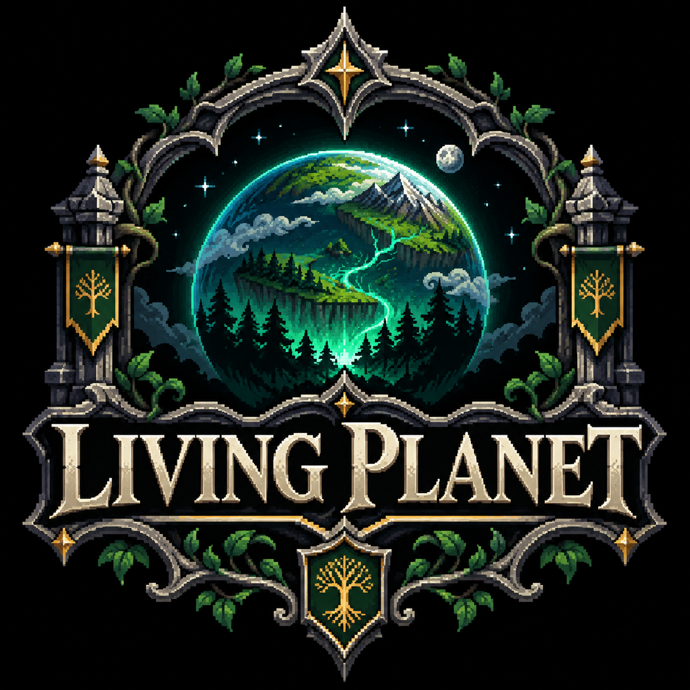
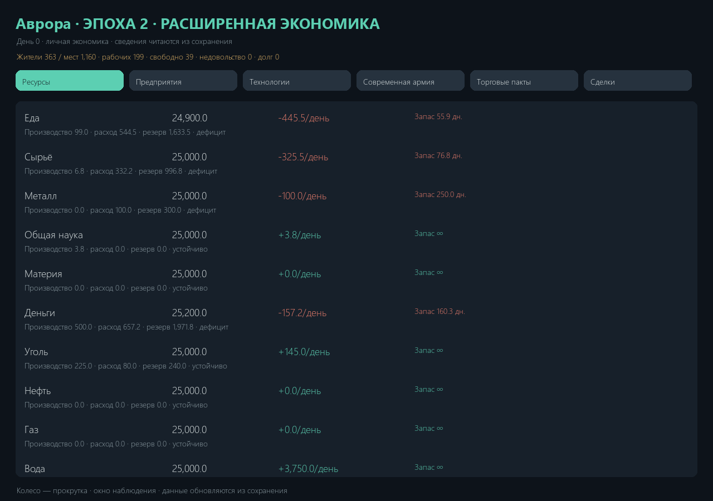

  

# Living Planet 8.5.0 · автономная Windows-сборка

**Живая планета теперь запускает локальную GGUF-модель сама. LM Studio, API-ключ и отдельный модельный сервер не нужны.**

## Скачать

- **Установщик:** `SETUPGAME.exe` — удобный мастер установки, выбор ярлыка с фирменной иконкой.
- **Переносимая версия:** `LivingPlanet-8.5.0-Portable.zip` — распакуйте и запустите `LivingPlanet/LivingPlanet.exe`.

Оба пакета включают приложение, пиксельную иконку Living Planet и официальный Windows Vulkan runtime llama.cpp. Веса модели в публичный релиз не включены: добавьте совместимый файл `.gguf` в `models` рядом с игрой и выберите его через **Модели · F2**. Уведомления о сторонних компонентах находятся в [THIRD_PARTY_NOTICES.md](https://github.com/TPECKA180/living-planet/blob/v8.5.0/docs/THIRD_PARTY_NOTICES.md).

## Что нового

- Встроен локальный запуск моделей из папки `models`; игра сама поднимает и завершает inference runtime.
- Удалены шаги подключения к LM Studio, ввод адреса сервера и API-ключа. Настройки модели адаптированы под локальное окно контекста и слои GPU.
- В интерфейс добавлена компактная скорость генерации в токенах в секунду.
- Исправлены значки окна приложения и ярлыков: обе сборки используют пиксельную эмблему проекта.
- Существующие миры и сохранения остаются в прежнем формате; игровой движок и баланс не менялись.

## Первый запуск

1. Установите игру через `SETUPGAME.exe` или распакуйте переносимый архив.
2. Скопируйте совместимую модель формата GGUF в папку `models` рядом с `LivingPlanet.exe`.
3. Нажмите **Модели · F2**, выберите файл и сохраните настройки.
4. Создайте мир и запустите один день либо наблюдение.

Большая модель может загружаться несколько минут. Если не хватает памяти, уменьшите размер контекста или число слоёв GPU в настройках. Подробности ошибок доступны в `logs/local-model.log`.

## Галерея

Скриншоты показывают демонстрационные миры и локальные настройки без личных сохранений.
