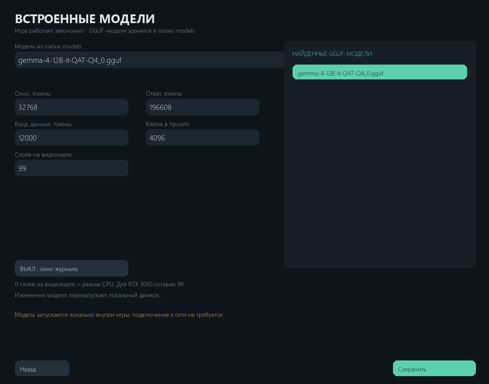

  

# Living Planet 8.5.2 · адаптивное окно и проверка локальной модели

**Living Planet заново собирает запрос с меньшим окном после отказа локального сервера и повторяет ход ограниченное число раз. Сейв и решения других государств сохраняются.**

> Reasoning отображается, только если его действительно передаёт выбранная модель. Living Planet не пытается извлечь скрытую внутреннюю цепочку рассуждений.

## Скачать

- **[SETUPGAME.exe — установить игру](https://github.com/TPECKA180/living-planet/releases/download/v8.5.2/SETUPGAME.exe)** · мастер установки, выбор папки и ярлык Living Planet.
- **[LivingPlanet-8.5.2-Portable.zip — переносимая версия](https://github.com/TPECKA180/living-planet/releases/download/v8.5.2/LivingPlanet-8.5.2-Portable.zip)** · распакуйте архив и запустите `LivingPlanet/LivingPlanet.exe`.

Публичные пакеты содержат игру, пиксельную иконку и встроенный Windows runtime llama.cpp. Веса GGUF в загрузку не входят: поместите свою модель в `models` рядом с игрой и выберите её в **Модели · F2**. LM Studio, Python, API-ключ и сетевой сервер не нужны. Сведения о сторонних компонентах — в [уведомлениях](https://github.com/TPECKA180/living-planet/blob/v8.5.2/docs/THIRD_PARTY_NOTICES.md).

## Что изменилось в 8.5.2

- Восстановлена автоматическая регенерация окна при ответе сервера о переполнении. Повтор строит запрос заново с меньшим пределом и прекращается после настроенного числа попыток.
- Исправлен чрезмерно большой принудительный минимум ответа: теперь отправляется заданный пользователем `max_tokens`, ограниченный фактическим свободным окном после промпта. Генерация не должна продолжаться до искусственного потолка в 110 000 токенов.
- Если крупный старый промпт не помещается в фактическое окно, карта, архив обучения, квитанции и каталоги уплотняются только в копии запроса. Сейв и действующие приказы не изменяются.
- Незавершённый ответ отбрасывается; при исчерпании попыток день и готовые решения сохраняются для повтора.
- Настройки 8.5.1 обновляются без сброса модели, окна контекста, лимитов, сейвов и локальной модели.
- Консоль потока модели снова включена по умолчанию и открывается во время наблюдения.
- В консоль поступают состояние генерации, reasoning при его наличии и обычный ответ модели.
- Настройки 8.5.0 и 8.5.1 обновляются при первом запуске 8.5.2. Размер контекста, выбранная модель и личные параметры сохраняются.
- Консоль можно выключить или включить обратно в окне **Модели · F2**.
- В окне генерации прямо поясняется, что скрытая цепочка рассуждений не извлекается.

## Быстрый старт

1. Установите игру через `SETUPGAME.exe` либо распакуйте переносимый архив.
2. Положите совместимый файл `.gguf` в папку `models` рядом с `LivingPlanet.exe`.
3. Откройте **Модели · F2**, выберите модель и сохраните настройки.
4. Создайте мир и нажмите **Наблюдать** или **Один день**. Консоль покажет поток модели отдельно от игрового окна.

В старых конфигурациях параметр консоли обновляется один раз. Если модель не отправляет reasoning, консоль всё равно показывает прогресс и её обычный ответ.

## Галерея Living Planet

  
  

  
  

  
  

Все снимки показывают подготовленные демонстрационные миры. Личные сохранения и модельные запросы в публичную галерею не входят. Полная [галерея из 11 экранов](https://github.com/TPECKA180/living-planet/blob/v8.5.2/docs/SCREENSHOTS.md) и [руководство по установке](https://github.com/TPECKA180/living-planet/blob/v8.5.2/docs/SETUP.md) доступны в репозитории.
