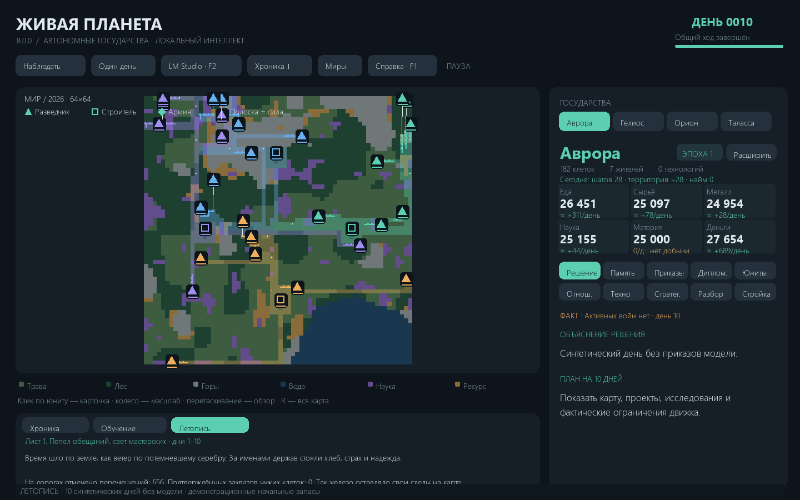

  

# Living Planet 8.5.3 · компактная память старых миров

**Старые письма, мысли и журнальные записи больше не отправляются модели целиком. После десяти игровых дней игра сворачивает их в короткие сводки, оставляя недавние записи подробными.**

## Скачать

- **[SETUPGAME.exe — установить игру](https://github.com/TPECKA180/living-planet/releases/download/v8.5.3/SETUPGAME.exe)** · выбор папки установки и ярлыка.
- **[LivingPlanet-8.5.3-Portable.zip — переносимая версия](https://github.com/TPECKA180/living-planet/releases/download/v8.5.3/LivingPlanet-8.5.3-Portable.zip)** · распакуйте архив и запустите `LivingPlanet/LivingPlanet.exe`.

Публичная сборка содержит игру и встроенный Windows runtime llama.cpp, но не содержит личную GGUF-модель и сохранения. Добавьте собственную `.gguf` в папку `models`. Игра не требует LM Studio.

## Что изменилось

- Переписка старше 10 игровых дней сворачивается по собеседникам; недавние письма остаются целиком.
- Память государств получает сжатую выжимку старых размышлений, заметок и планов. Последние мысли сохраняются подробно.
- Старые события и история сворачиваются только для запроса к модели. Полный архив, SQLite-сохранение и записи решений не переписываются.
- Исторические размышления добавляются к временному контексту из журнала решений, после чего старые мысли сжимаются тем же правилом.
- Для локальной модели включён компактный набор инструкций, а передаваемая карта ограничена 2 048 важными видимыми клетками.
- Внутренний reasoning локального движка ограничен 1 024 токенами на ход, чтобы модель быстрее переходила к игровому JSON. Поле `thinking` остаётся в решении, а reasoning по-прежнему поступает в консоль.
- Конфигурация 8.5.2 обновляется один раз: модель, окно модели, лимит ответа и сохранения остаются прежними; лимит входа ограничивается 72 000, карта — 2 048 клетками, reasoning получает бюджет 1 024 токена.
- Временные сводки формируются заново для каждого запроса. В исходные данные мира они не записываются.

## Проверка на локальном компьютере

На Windows 10, RTX 3060 12 ГБ и 16 ГБ ОЗУ прогнаны два реальных запроса через локальную GGUF-модель; исходные SQLite-сохранения открывались только для чтения, игровые решения в них не применялись.

| Сценарий | Время | Обработанный вход | Выход модели | Скорость генерации | Итог |
|---|---:|---:|---:|---:|---|
| Поздний мир, день 140 | 9 мин 30 с | 54 841 токен | 2 299 токенов | 30,1 токена/с | Решение получено: 5 действий и 2 дипломатических ответа |
| Новый мир, день 0 | 3 мин 29 с | 13 660 токенов суммарно по двум вызовам | 3 325 токенов | 32,9 и 35,1 токена/с | Решение получено: 9 действий и 1 дипломатический ответ |

Также прошли 28 точечных тестов миграции, возрастного сжатия, сохранения свежих записей и формирования фактически отправляемого модели запроса. Проверка состава релиза завершилась без ошибок. Время зависит от модели и компьютера; длительная обработка большого позднего мира остаётся заметной.
## Установка и данные

1. Откройте `SETUPGAME.exe` и выберите папку установки.
2. В папке `models` разместите свою модель `.gguf` и выберите её через **Модели · F2**.
3. Старые сохранения остаются целыми; игра сжимает только их копию для запроса.

  
  

  
  

Примеры экранов и справка — в [галерее](docs/SCREENSHOTS.md) и [руководстве](docs/GAME_GUIDE.md). Отчёт локальной проверки конкретного релиза публикуется в этой заметке после завершения проверки.

---

  

# Living Planet 8.5.2 · адаптивное окно и проверка локальной модели

**Living Planet заново собирает запрос с меньшим окном после отказа локального сервера и повторяет ход ограниченное число раз. Сейв и решения других государств сохраняются.**

> Reasoning отображается, только если его действительно передаёт выбранная модель. Living Planet не пытается извлечь скрытую внутреннюю цепочку рассуждений.

## Скачать

- **[SETUPGAME.exe — установить игру](https://github.com/TPECKA180/living-planet/releases/download/v8.5.2/SETUPGAME.exe)** · мастер установки, выбор папки и ярлык Living Planet.
- **[LivingPlanet-8.5.2-Portable.zip — переносимая версия](https://github.com/TPECKA180/living-planet/releases/download/v8.5.2/LivingPlanet-8.5.2-Portable.zip)** · распакуйте архив и запустите `LivingPlanet/LivingPlanet.exe`.

Публичные пакеты содержат игру, пиксельную иконку и встроенный Windows runtime llama.cpp. Веса GGUF в загрузку не входят: поместите свою модель в `models` рядом с игрой и выберите её в **Модели · F2**. LM Studio, Python, API-ключ и сетевой сервер не нужны. Сведения о сторонних компонентах — в [уведомлениях](https://github.com/TPECKA180/living-planet/blob/v8.5.2/docs/THIRD_PARTY_NOTICES.md).

## Что изменилось в 8.5.2

- Восстановлена автоматическая регенерация окна при ответе сервера о переполнении. Повтор строит запрос заново с меньшим пределом и прекращается после настроенного числа попыток.
- Исправлен чрезмерно большой принудительный минимум ответа: теперь отправляется заданный пользователем `max_tokens`, ограниченный фактическим свободным окном после промпта. Генерация не должна продолжаться до искусственного потолка в 110 000 токенов.
- Если крупный старый промпт не помещается в фактическое окно, карта, архив обучения, квитанции и каталоги уплотняются только в копии запроса. Сейв и действующие приказы не изменяются.
- Если обязательный контекст старого сохранения немного превышает целевой `input_tokens`, игра теперь использует ограниченный запас до 25% (не более 24 000 токенов), только когда весь запрос с резервом помещается в реальное окно модели.
- Незавершённый ответ отбрасывается; при исчерпании попыток день и готовые решения сохраняются для повтора.
- Настройки 8.5.1 обновляются без сброса модели, окна контекста, лимитов, сейвов и локальной модели.
- Консоль потока модели снова включена по умолчанию и открывается во время наблюдения.
- В консоль поступают состояние генерации, reasoning при его наличии и обычный ответ модели.
- Настройки 8.5.0 и 8.5.1 обновляются при первом запуске 8.5.2. Размер контекста, выбранная модель и личные параметры сохраняются.
- Консоль можно выключить или включить обратно в окне **Модели · F2**.
- В окне генерации прямо поясняется, что скрытая цепочка рассуждений не извлекается.

## Быстрый старт

1. Установите игру через `SETUPGAME.exe` либо распакуйте переносимый архив.
2. Положите совместимый файл `.gguf` в папку `models` рядом с `LivingPlanet.exe`.
3. Откройте **Модели · F2**, выберите модель и сохраните настройки.
4. Создайте мир и нажмите **Наблюдать** или **Один день**. Консоль покажет поток модели отдельно от игрового окна.

В старых конфигурациях параметр консоли обновляется один раз. Если модель не отправляет reasoning, консоль всё равно показывает прогресс и её обычный ответ.

## Галерея Living Planet

  
  

  
  

  
  

Все снимки показывают подготовленные демонстрационные миры. Личные сохранения и модельные запросы в публичную галерею не входят. Полная [галерея из 11 экранов](https://github.com/TPECKA180/living-planet/blob/v8.5.2/docs/SCREENSHOTS.md) и [руководство по установке](https://github.com/TPECKA180/living-planet/blob/v8.5.2/docs/SETUP.md) доступны в репозитории.
