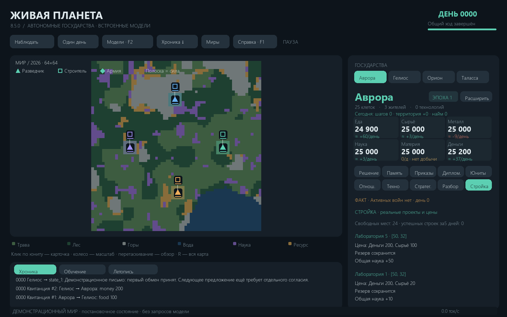
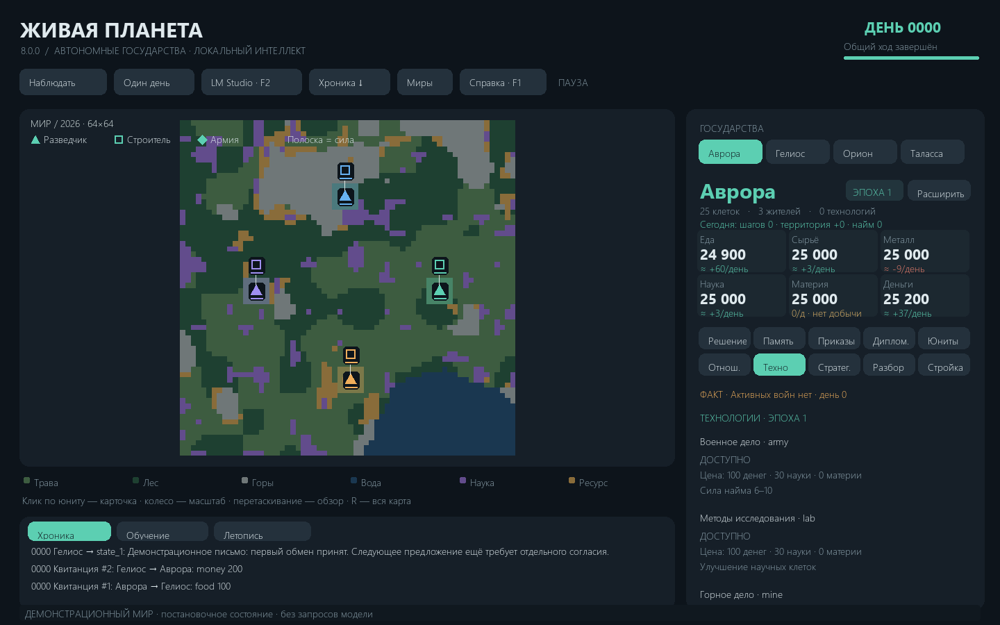
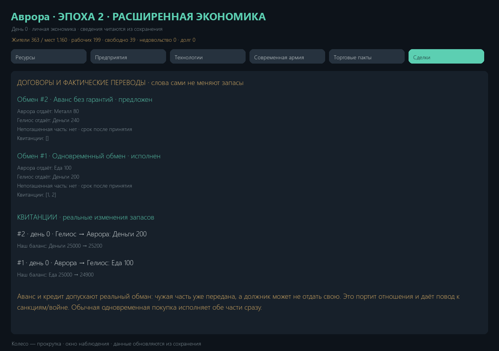

  

# Living Planet 8.0.1 · Windows Edition

**Живые государства. Локальные нейросети. Мир, который развивается из настоящих решений.**

Обновление 8.0.1 упаковывает игру в простое Windows-приложение с собственной пиксельной эмблемой Living Planet. Установщик создаёт ярлык в меню «Пуск» и предлагает ярлык на рабочем столе. Для тех, кто не хочет ничего устанавливать, доступен переносимый архив.

## Скачать и запустить

### Рекомендуется: установщик

Скачайте **`LivingPlanet-Setup-8.0.1.exe`** в разделе Assets ниже и запустите файл. Установка выполняется для текущей учётной записи Windows и не требует прав администратора. Затем откройте **Living Planet** в меню «Пуск».

### Без установки: переносимая версия

Скачайте **`LivingPlanet-8.0.1-Portable.zip`**, распакуйте его в обычную папку, куда Windows разрешает записывать файлы, и откройте `LivingPlanet/LivingPlanet.exe`. Не запускайте EXE прямо из ZIP.

**Python и pygame устанавливать не требуется.** При первом запуске приложение создаёт собственные настройки и папку новых сохранений рядом с установленной программой.

## Что изменилось

- Готовое приложение `LivingPlanet.exe`, собранное для Windows 64-bit.
- Установщик с фирменной иконкой EXE, ярлыка и удаления программы.
- Ярлык в меню «Пуск» и необязательный ярлык на рабочем столе.
- ZIP-версия для запуска без установки.
- Поддержка игровых окон и консоли потока модели в упакованной версии.
- Новая оригинальная пиксельная эмблема: светящаяся планета, тёмный лес, средневековая арка и надпись **LIVING PLANET**.
- Механики симуляции, экономика, промпты, контракты решений и формат сохранений 6 унаследованы от 8.0.0 без изменений.

## Первое подключение

Релиз содержит игру, **но не содержит** нейросетевую модель, её веса, API-ключ или пользовательские сохранения. Установите LM Studio либо другой совместимый сервер модели и отдельно загрузите подходящую языковую модель. Затем запустите игру, укажите сервер в настройках и создайте новый мир. Пошаговая инструкция: [настройка и первый запуск](https://github.com/TPECKA180/living-planet/blob/v8.0.1/docs/SETUP.md).

Сохранения в репозитории отсутствуют. Игра создаёт новую локальную папку сохранений при запуске — личные миры не попадают в программу установки или публичный архив.

## Галерея проекта

Ниже — настоящие экраны игры. Иллюстрации подготовлены на демонстрационных мирах, без личных сохранений и запросов к нейросети.

### 01 · Карта и государства

### 02 · Создание мира

### 03 · Архипелаг

### 04 · Детали живого мира

### 05 · Строительство

### 06 · Исследования

### 07 · Отношения

### 08 · Индустриальная эпоха

### 09 · Производство

### 10 · Торговля

### 11 · История мира

## Документация

- [Установка и первый запуск](https://github.com/TPECKA180/living-planet/blob/v8.0.1/docs/SETUP.md)
- [Галерея скриншотов](https://github.com/TPECKA180/living-planet/blob/v8.0.1/docs/SCREENSHOTS.md)
- [Игровое руководство](https://github.com/TPECKA180/living-planet/blob/v8.0.1/docs/GAME_GUIDE.md)
- [Что входит в проект и его ограничения](https://github.com/TPECKA180/living-planet/blob/v8.0.1/docs/LIMITS.md)
- [История изменений](https://github.com/TPECKA180/living-planet/blob/v8.0.1/CHANGELOG.md)
