# Архитектура проекта

## Поток данных

```mermaid
flowchart LR
    UI[Pygame / наблюдатель] --> Runner[Рабочий поток Runner]
    Runner --> Context[World.context / личные факты]
    Context --> Budget[Бюджет и точная упаковка]
    Budget --> LM[LM Studio / chat completions]
    LM --> Decision[Проверка JSON и владельца]
    Decision --> Prepare[Локальная подготовка]
    Prepare --> Pending[Сохранённые решения всех стран]
    Pending --> Clone[Общее исполнение на клоне]
    Clone --> Store[SQLite и экспорты]
    Store --> UI
```

UI и рабочая симуляция используют разные снимки. Сеть и расчёт решений не должны блокировать pygame event loop. Runner сообщает status/world/activity/retry/error/done через очередь; UI принимает сохранённый снимок и очищает только свои производные кэши. Не следует отдавать UI живой mutable-объект рабочего мира.

## Слои

| Модуль | Ответственность |
| --- | --- |
| main.py | App, Runner, игровой UI, управление днями, входная точка |
| configuration / runtime_config | Чистые значения, первый запуск и миграция предпочтений |
| launcher / dialogs | Выбор/создание/импорт мира, настройки и скрытое поле ключа |
| engine / rules | Cell,State,World,Store, фазы, основной dispatch, RuleError |
| geography / pixel_art / modern_art | Seeded-география, острова, процедурные пиксельные спрайты |
| economy / technology / infrastructure | Прогноз первой эпохи, исследования, выпуск, стены/башни/материя |
| mobility / naval | Маршруты, шаги, найм, дежурные службы, корабли и десант |
| diplomacy / politics | Единый статус войн, досье, капитуляция, обещания и вассалы |
| commerce / modern_trade | Казначейство, реальные квитанции, обмены, поставки, неисполнение |
| modern_catalog / modern / modern_economy | Числа второй эпохи, личный переход, заводы, кризисы, снабжение, ракеты |
| strategy / planning / military_ai | Обстановка, готовые проекты/места/найм, военный ответ |
| brain / isolation / brain_errors | API, выбор экземпляра, JSON, языковая проверка, строгая изоляция |
| current_prompt / intelligence / deliberation / decision_format | Действующие правила, нормализация, контракты и схемы решений |
| context / prompt_packing / response_io | Уплотнение запроса, защита фактов и ограничение входящего ответа |
| local_execution / execution_ai | Подготовка/предпросмотр обычных приказов; старый нейросетевой режим сохранён |
| construction_ai / economic_ai | Совместимость советников/компиляции, не отдельные обязательные запросы по умолчанию |
| local_chronicle | Детерминированные главы без привилегированной страны |
| learning | Ежедневные награды, эпизоды, эксперименты и подпись готового решения |
| performance | Производные кэши анализа, инвалидируемые изменением мира |
| text_layout / view_safety | Ограниченный кэш разметки и проверка отображаемого разбора |
| diagnostics / console_feed / console_monitor | Traceback, поток генерации и отдельная Windows-консоль |
| relations_window / industry_window | Отдельные окна на сохранённом состоянии |
| saves | Библиотека миров, экспорт, резервные копии, ручной импорт, session.lock |

## Инварианты

- Земля/вода проверяются движком при построении маршрута и фактическом шаге; промт не является защитой проходимости.
- Платёж и изменение мира выполняются только успешным реальным действием; текст не служит квитанцией.
- Стороны и роли сделок проверяются по ID; нельзя принять собственное предложение за партнёра.
- Все страны общего дня планируют до применения решений; порядок исполнения циклический, не физически одновременный.
- Приватная память помечена владельцем и не должна попасть в чужой запрос.
- Предпросмотр и упаковка работают на копиях; они не тратят настоящий бюджет и не меняют сохранённый характер.
- Эпоха определяется своим industrialization, а не полем чужой страны или захваченным зданием.
- Готовность решения связана подписью с содержимым; награды и общее исполнение не начисляются повторно от открытия окна.
- Архив сокращается только для запроса. Если оперативное ядро не помещается, оно не заменяется одной identity.

## Формат сохранения и версия

Приложение называется 7.5.0, внутренний сериализованный format version остаётся 6. patch отражает редакцию поведения/миграции, а не необходимость менять структуру ради номера релиза. Новые поля имеют разумные значения по умолчанию при restore; перед изменением старого снимка создаётся SQLite-копия. Тесты обратной совместимости используют синтетические миры, а не вложенные личные сейвы.
