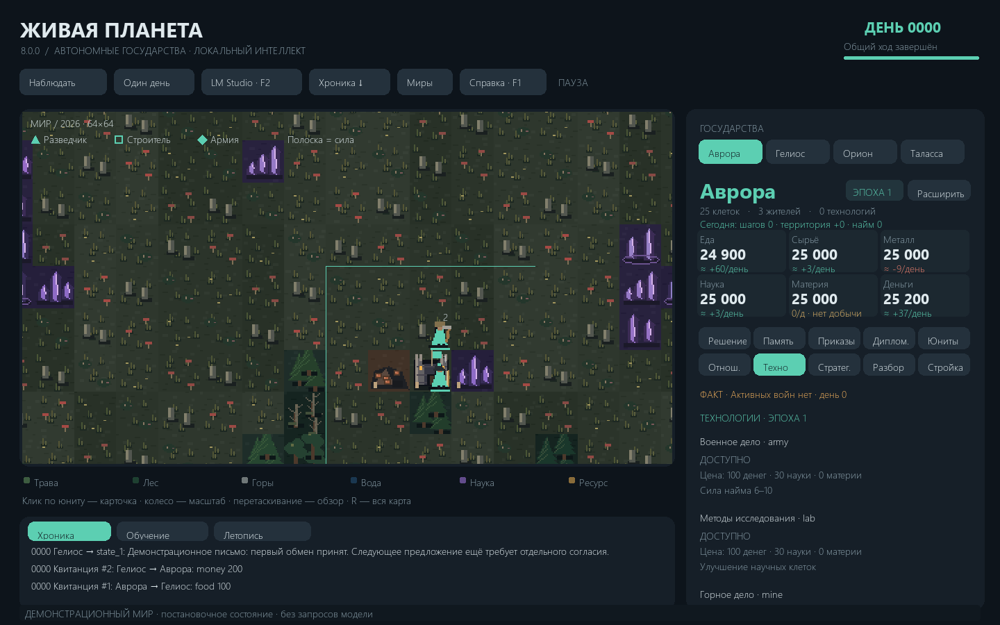
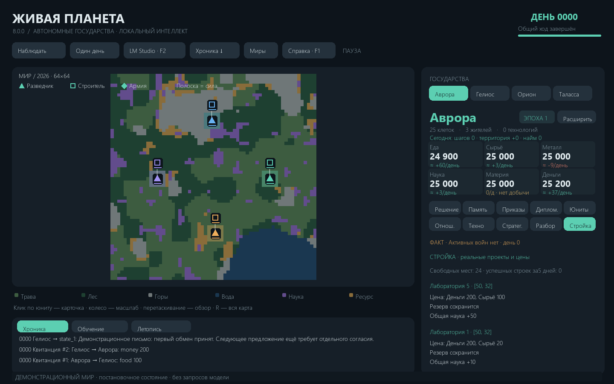
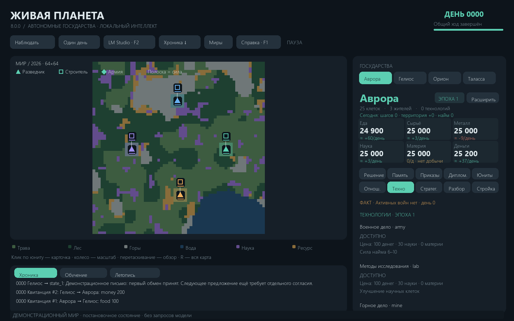
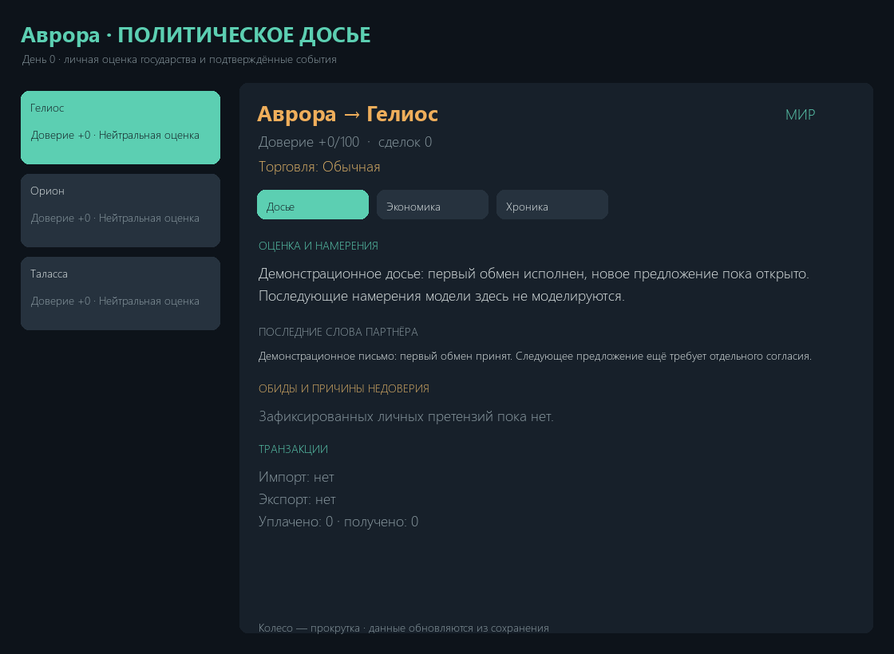
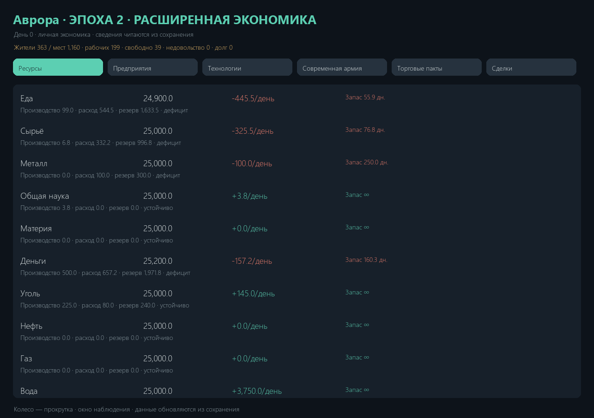
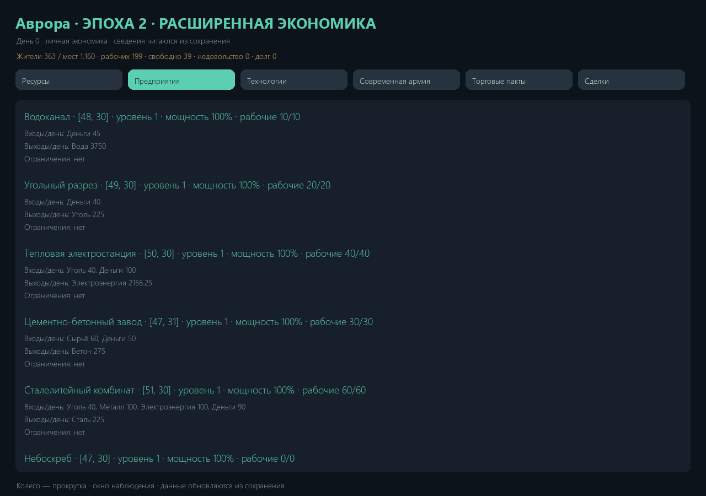
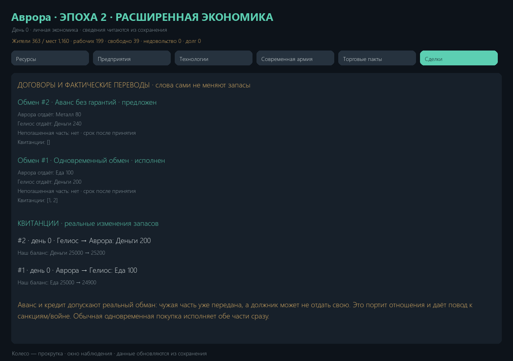
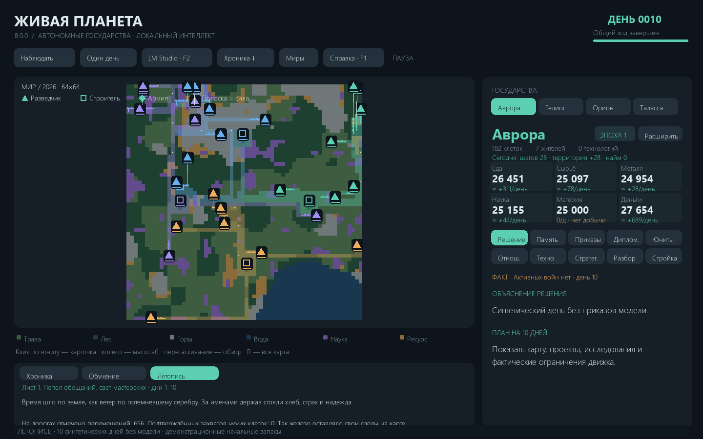

# Галерея интерфейса · 10 экранов

Все изображения получены из настоящего интерфейса pygame командой `python tools/render_gallery.py`. Они показывают специально подготовленные синтетические миры; личные настройки, сохранения и журналы не используются. Увеличенные запасы, заранее открытые технологии и выставленные предприятия нужны для показа экранов, а не для демонстрации стартового баланса или качества модели.

[На главную](../README.md) · [Руководство игрока](GAME_GUIDE.md) · [Каталоги](CATALOGS.md)

## Общий вид

Карта, выбранная страна, ресурсы, решение и хроника. Это новый демонстрационный мир: показанные запасы заданы для иллюстрации, модель не запускалась.


## Карта крупным планом

Реальные пиксельные спрайты местности, зданий и юнитов при увеличении. Снимок показывает отображение клеток, а не команду управления страной.



## Архипелаг

Шесть крупных островов в мире с seed 2026. Для межостровных операций действуют обычные правила кораблей и десанта.


## Строительство

Меню проектов показывает конкретные здания, цены и ограничения. Выбранный моделью проект должен пройти проверки движка и оплату.



## Технологии

Технологический каталог первой эпохи: доступность, стоимость и эффект. Индустриальный переход исследуется каждой страной отдельно.



## Дипломатическое досье

Собственные оценки партнёров, доверие и подтверждённые факты. Чужая закрытая память не становится общей информацией.



## Ресурсы и прогноз

Расширенная экономика эпохи II. Запасы, прогнозы, расходы и резервы — снимок синтетической страны с открытыми технологиями.



## Предприятия

Рабочие, мощность, входы, выпуск и узкие места реальных предприятий. Постановочная конфигурация позволяет увидеть несколько цепочек в одном кадре.



## Сделки

Окно учёта торговых операций. Один синтетический взаимный обмен исполнен обычным движком, второе предложение остаётся открытым. На экране видны договоры и квитанции фактических переводов; решения заданы программно, без модели.



## Летопись

Глава после десяти программных дней без приказов модели. Текст сформирован локальной системой истории; это не результат живой нейросетевой кампании.



## Как воспроизвести

```bash
python -m pip install -r requirements.txt
python tools/render_gallery.py
```

Скрипт создаёт снимки в `docs/assets`, временные SQLite — в системной временной папке и удаляет их при завершении. Для размещения временных файлов на другом диске перед запуском задайте `TEMP` и `TMP` в Windows либо `TMPDIR` в Linux. LM Studio для генерации галереи не требуется.
