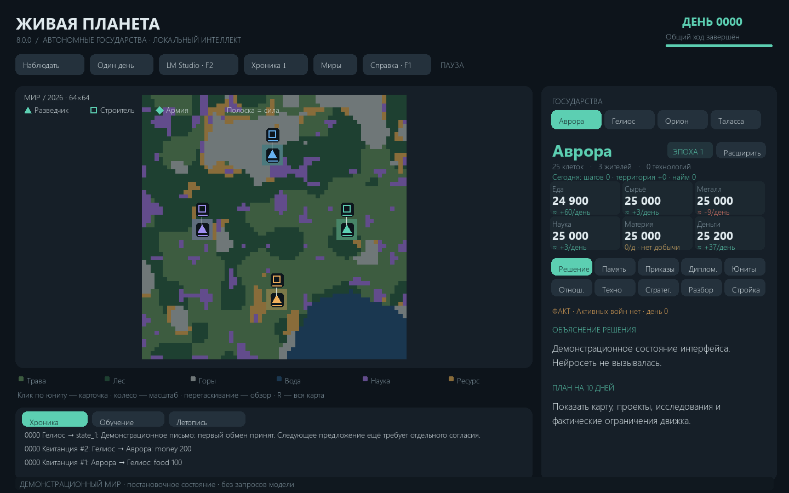

Original Living Planet («Живая планета») was created by TPECKA180; original source: https://github.com/TPECKA180/living-planet.

# 🌍 Living Planet — des civilisations autonomes pilotées par l’IA

**Modèles de langage locaux. États indépendants. Une histoire façonnée par des décisions réelles.**

**Languages / Языки:** [English](../en/README.md) · [Русский](../../../README.md) · [Español](../es/README.md) · [简体中文](../zh-CN/README.md) · [Português (Brasil)](../pt-BR/README.md) · [Deutsch](../de/README.md) · [Français](../fr/README.md) · [日本語](../ja/README.md) · [한국어](../ko/README.md) · [Italiano](../it/README.md)



Living Planet est un simulateur de grande stratégie dans lequel 2 à 6 États sont dirigés par des modèles de langage exécutés localement. Chaque pays possède ses ressources, son territoire, ses plans, sa diplomatie et sa mémoire. Créez un monde et observez comment les nations construisent, négocient, commercent, se battent et subissent les conséquences.

## Fonctionnement de la simulation

Le moteur Python vérifie les ordres structurés de l’IA selon la propriété des territoires, les ressources, les technologies, les itinéraires et les traités. Déclarer « je construis une usine » ne crée pas d’usine sans conditions ni financement réels.

55 types d’actions · 31 ressources · 2 ères · 25 + 33 technologies · 45 bâtiments industriels · 8 types de troupes modernes. L’économie comprend main-d’œuvre, chaînes de production, énergie, entretien, ravitaillement et crises. Les cartes sont reproductibles grâce à une graine et un mode archipel est proposé.

## Démarrage rapide

1. Installez Python 3.12 et LM Studio. Téléchargez un modèle instruct/chat capable de générer du JSON structuré et activez le serveur dans **Developer**.
2. Téléchargez le dépôt en ZIP, extrayez-le dans un dossier accessible en écriture, puis lancez `install.bat` sous Windows.
3. Exécutez `run.bat`, ouvrez **LM Studio** (ou `F2`), saisissez `http://localhost:1234/v1`, actualisez les modèles et choisissez-en un.
4. Créez un monde de 2 à 6 pays, puis lancez un jour de simulation ou l’observation (l’interface actuelle est en russe).

```bash
python -m pip install -r requirements.txt
python main.py
```

**Le téléchargement **n’inclut pas** de modèle, de poids, de sauvegardes ou de clés API. La version publique v8.0.0 exige un serveur compatible ; elle ne lance pas directement de modèle depuis `models`. La mémoire et les récompenses servent de retour d’information, **sans entraînement des poids du modèle**.**


## Documentation et licence

- [Installation détaillée](SETUP.md)
- [Guide complet (russe)](../../GAME_GUIDE.md)
- [Galerie de captures](../../SCREENSHOTS.md)
- [Licence : gratuité permanente et attribution obligatoire](../../../LICENSE) · [Русский перевод лицензии](../../../LICENSE.ru.md)
- [GitHub / Source](https://github.com/TPECKA180/living-planet)

Le manuel complet et la documentation technique d’origine sont pour l’instant en russe. Cette page et le guide d’installation traduit sont des introductions localisées, **pas une traduction de l’interface du jeu**.

Toute redistribution ou modification doit conserver le crédit du créateur initial et le lien vers le dépôt d’origine.
