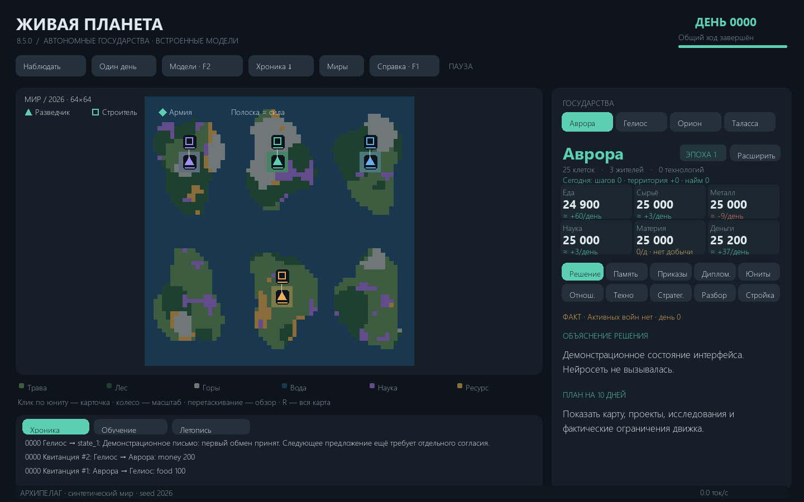

Original Living Planet («Живая планета») was created by TPECKA180; original source: https://github.com/TPECKA180/living-planet.

# 🌍 Living Planet — civilizações autônomas com IA

**Modelos de linguagem locais. Países independentes. História construída por decisões reais.**

**Languages / Языки:** [English](../en/README.md) · [Русский](../../../README.md) · [Español](../es/README.md) · [简体中文](../zh-CN/README.md) · [Português (Brasil)](../pt-BR/README.md) · [Deutsch](../de/README.md) · [Français](../fr/README.md) · [日本語](../ja/README.md) · [한국어](../ko/README.md) · [Italiano](../it/README.md)


Living Planet é um simulador de grande estratégia no qual 2 a 6 países são governados por modelos de linguagem executados localmente. Cada país possui recursos, território, planos, diplomacia e memória próprios. Crie um mundo e acompanhe como eles constroem, negociam, comercializam, entram em guerra e enfrentam consequências.

## Como funciona a simulação

O motor em Python valida as ordens estruturadas das IAs de acordo com território, recursos, tecnologias, rotas e tratados. Dizer “vou construir uma fábrica” não cria uma fábrica sem condições e recursos reais.

55 tipos de ações · 31 recursos · 2 eras · 25 + 33 tecnologias · 45 edifícios da era industrial · 8 tipos de tropas modernas. A economia inclui trabalhadores, cadeias produtivas, energia, manutenção, suprimentos e crises. Há mapas reproduzíveis por seed e um modo arquipélago.

## Início rápido

1. Instale Python 3.12 e LM Studio. Baixe um modelo instruct/chat capaz de produzir JSON estruturado e ative o servidor em **Developer**.
2. Baixe o repositório como ZIP, extraia em uma pasta gravável e execute `install.bat` no Windows.
3. Inicie `run.bat`; abra **LM Studio** (ou `F2`), informe `http://localhost:1234/v1`, atualize a lista e selecione um modelo.
4. Crie um mundo com 2–6 países e use o comando de avançar um dia ou observar (a interface atual está em russo).

```bash
python -m pip install -r requirements.txt
python main.py
```

**O download **não inclui** modelo, pesos, saves ou chaves de API. A versão pública v8.0.0 exige um servidor de modelo compatível; ela não inicia modelos diretamente da pasta `models`. Memória e recompensas fornecem feedback, **sem treinar os pesos do modelo**.**



## Documentação e licença

- [Instalação detalhada](SETUP.md)
- [Guia completo (russo)](../../GAME_GUIDE.md)
- [Galeria de imagens](../../SCREENSHOTS.md)
- [Licença: distribuição gratuita e crédito obrigatório](../../../LICENSE) · [Русский перевод лицензии](../../../LICENSE.ru.md)
- [GitHub / Source](https://github.com/TPECKA180/living-planet)

O guia completo do jogo e as referências técnicas originais ainda estão em russo. Esta página e o guia de instalação traduzido são introduções localizadas, **não** uma tradução da interface do jogo.

Ao redistribuir ou modificar o projeto, mantenha os créditos do criador original e o link do repositório.
